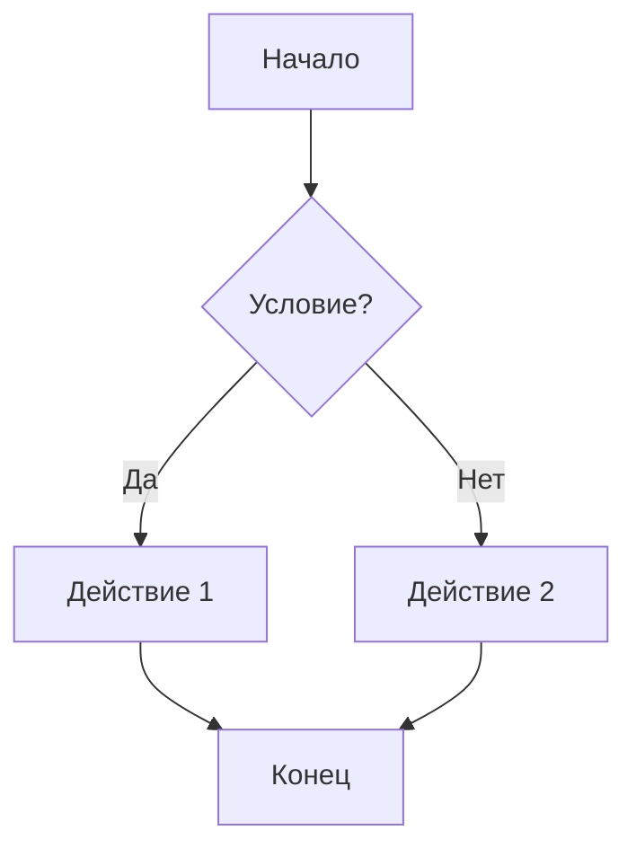
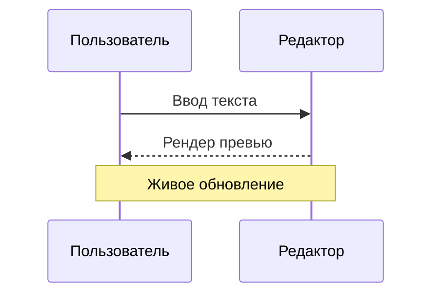
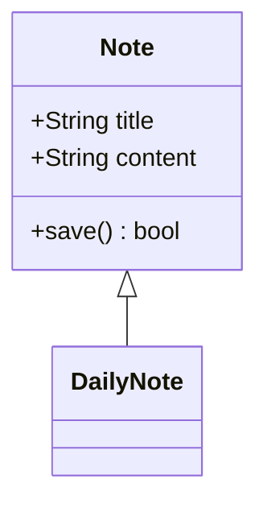
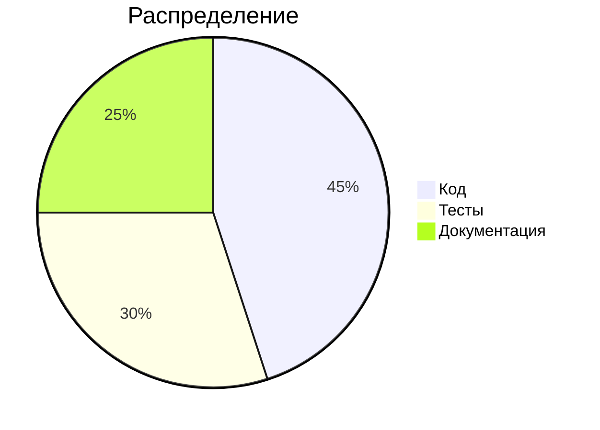

# Полный тест Markdown-редактора

Этот файл содержит **все основные** (и многие расширенные) элементы Markdown: CommonMark, GFM и популярные расширения. Используйте его для проверки парсинга, рендеринга, подсветки синтаксиса и горячих клавиш.

[TOC]

---

## 1. Заголовки

# Заголовок H1
## Заголовок H2
### Заголовок H3
#### Заголовок H4
##### Заголовок H5
###### Заголовок H6

Заголовок H1 (Setext)
=====================

Заголовок H2 (Setext)
---------------------

####### Семь решёток — это НЕ заголовок

#Без пробела — это НЕ заголовок

# Заголовок с закрывающими решётками #

## Заголовок с `кодом`, **жирным** и [ссылкой](https://example.com)

### Заголовок с эмодзи 🚀 и юникодом — «ёлочки» „лапки“

## 2. Абзацы и переносы строк

Первый абзац. Он состоит из нескольких строк,
которые склеиваются в одну (мягкий перенос).

Второй абзац после пустой строки.

Жёсткий перенос через два пробела в конце строки  
эта строка идёт с новой строки.

Жёсткий перенос через обратный слэш\
эта строка тоже на новой строке.

Жёсткий перенос через `<br>`:<br>новая строка.

Очень длинная строка без переносов для проверки переноса по словам и горизонтального скролла: Lorem ipsum dolor sit amet, consectetur adipiscing elit, sed do eiusmod tempor incididunt ut labore et dolore magna aliqua. Ut enim ad minim veniam, quis nostrud exercitation ullamco laboris nisi ut aliquip ex ea commodo consequat. Длиннаяпоследовательностьбезпробеловдляпроверкипереносаслов_и_переполнения_контейнера_ещё_длиннее_и_длиннее_и_длиннее_и_длиннее.

## 3. Форматирование текста

*Курсив со звёздочками* и _курсив с подчёркиваниями_.

**Жирный со звёздочками** и __жирный с подчёркиваниями__.

***Жирный курсив*** и ___жирный курсив___ и **_смешанный_** и *__смешанный__*.

~~Зачёркнутый текст~~ (GFM).

==Выделенный текст== (расширение highlight).

H~2~O — нижний индекс. E = mc^2^ — верхний индекс.

<sub>HTML sub</sub> и <sup>HTML sup</sup>, <u>подчёркнутый</u>, <mark>mark</mark>, <kbd>Ctrl</kbd> + <kbd>S</kbd>, <small>мелкий</small>, <ins>вставка</ins>, <del>удаление</del>.

`Встроенный код`, ``код с `обратными` кавычками внутри``, ` пробелы по краям `.

Вложенное: **жирный с *курсивом* внутри и `кодом`**, *курсив с **жирным** внутри*, ~~зачёркнутый с **жирным**~~.

Слова_с_подчёркиваниями_внутри не должны становиться курсивом. 2*3*4 — тоже спорный случай. snake_case_name и __init__.py.

Экранирование: \*не курсив\*, \_не курсив\_, \# не заголовок, \[не ссылка\], \`не код\`, \\ обратный слэш, \> не цитата, \- не список, \| не таблица.

HTML-сущности: &copy; &amp; &lt; &gt; &quot; &nbsp; &mdash; &hellip; &euro; &#169; &#x2764;

## 4. Цитаты

> Простая цитата в одну строку.

> Многострочная цитата,
> продолжающаяся на нескольких строках
> с мягким переносом.
>
> Второй абзац внутри цитаты.

> Вложенные цитаты:
>
> > Второй уровень
> >
> > > Третий уровень
>
> Возврат на первый уровень.

> ### Заголовок в цитате
>
> - Список в цитате
> - Второй пункт
>
> ```python
> print("Код в цитате")
> ```
>
> **Жирный** и *курсив* в цитате.

> Цитата с ленивым продолжением
строка без символа `>`.

## 5. Списки

### Маркированные

- Пункт с дефисом
- Второй пункт
- Третий пункт

* Пункт со звёздочкой
* Второй пункт

+ Пункт с плюсом
+ Второй пункт

### Нумерованные

1. Первый
2. Второй
3. Третий

1. Все единицы
1. Все единицы
1. Все единицы

5. Начало с пяти
6. Шестой
7. Седьмой

1) Скобка вместо точки
2) Второй пункт

### Вложенные списки

- Уровень 1
	- Уровень 2
    - Уровень 3
		- Уровень 4
        - Уровень 5
    - Ещё уровень 3
- Ещё уровень 2
- Ещё уровень 1

1. Первый
	1. Вложенный нумерованный
	2. Второй вложенный
		- Маркированный внутри нумерованного
		- Ещё один
2. Третий вложенный
3. Второй
	- Маркер в нумерованном
4. Третий

### Списки со сложным содержимым

1. Пункт с абзацами

   Второй абзац внутри пункта (отступ 3 пробела).

   ```bash
   echo "Код внутри пункта списка"
   ```

 > Цитата внутри пункта

1. Пункт с таблицей:
| A | B |
| --- | --- |
| 1 | 2 |
<!--q-table:{"merges":[],"cols":[231,334]}-->

1. Пункт с изображением: 

- Свободный список (с пустыми строками между пунктами)

- Второй пункт

- Третий пункт

### Списки задач (GFM)

- [ ] Невыполненная задача
- [x] Выполненная задача
- [X] Выполненная (заглавная X)
- [ ] Задача с **форматированием** и `кодом`
	- [ ] Вложенная задача
	- [x] Вложенная выполненная
		- [ ] Ещё глубже
- [ ] Задача со [ссылкой](https://example.com)

1. [ ] Нумерованная задача
2. [x] Нумерованная выполненная

### Список определений (расширение)

Термин 1
: Определение первого термина.

Термин 2
: Первое определение.
: Второе определение.

## 6. Блоки кода

Блок с отступом в 4 пробела:

    function indented() {
        return "это блок кода с отступом";
    }

Блок без указания языка:

```
Простой текст
    с сохранением   пробелов
и <html> & "спецсимволами"
```

Блок с тильдами:

~~~
Код в блоке с тильдами
~~~

Блок с четырьмя обратными кавычками (содержит тройные внутри):

````markdown
```js
console.log("вложенный блок");
```
````

### Подсветка синтаксиса

```javascript
// JavaScript
const greet = (name = "мир") => `Привет, ${name}!`;
class Foo extends Bar {
  async run() { await Promise.all([1, 2, 3].map(x => x ** 2)); }
}
console.log(greet(), /regex[a-z]+/gi.test("abc"), 0xFF, 1_000, null, undefined);
```

```typescript
interface User<T = unknown> { id: number; name?: string; meta: T }
type Fn = (a: number, ...rest: string[]) => Promise<void>;
enum Color { Red = "RED", Green = "GREEN" }
```

```python
# Python
from dataclasses import dataclass

@dataclass
class Point:
    x: float = 0.0
    y: float = 0.0

def fib(n: int) -> int:
    """Docstring."""
    return n if n < 2 else fib(n - 1) + fib(n - 2)

print(f"{fib(10)=}", [i**2 for i in range(5)], {"k": 'v'}, lambda x: x)
```

```rust
// Rust
use std::collections::HashMap;

#[derive(Debug, Clone)]
struct Note<'a> { title: &'a str, tags: Vec<String> }

impl<'a> Note<'a> {
    fn new(title: &'a str) -> Self { Self { title, tags: vec![] } }
}

fn main() -> Result<(), Box<dyn std::error::Error>> {
    let mut map: HashMap<String, i32> = HashMap::new();
    map.insert("key".to_string(), 42);
    println!("{:?} {}", map, r#"raw "string""#);
    Ok(())
}
```

```go
package main

import "fmt"

func main() {
	ch := make(chan int, 1)
	go func() { ch <- 42 }()
	fmt.Println(<-ch)
}
```

```c
#include <stdio.h>
#define MAX(a, b) ((a) > (b) ? (a) : (b))
int main(void) { printf("%d\n", MAX(1, 2)); return 0; }
```

```cpp
#include <vector>
template <typename T>
auto sum(const std::vector<T>& v) { T s{}; for (auto& x : v) s += x; return s; }
```

```java
public class Main {
    public static void main(String[] args) {
        System.out.println("Hello");
    }
}
```

```html
<!DOCTYPE html>
<html lang="ru">
  <head><meta charset="utf-8"><title>Тест</title></head>
  <body class="a b" data-x="1">
    <!-- комментарий -->
    <p>Текст &amp; <b>жирный</b></p>
  </body>
</html>
```

```css
:root { --accent: #ff6600; }
.card > a:hover::after { content: "→"; color: var(--accent); margin: 0 auto; }
@media (max-width: 600px) { body { font: 14px/1.5 sans-serif; } }
```

```json
{
  "name": "test",
  "version": "1.0.0",
  "nested": { "array": [1, 2.5, true, null, "str"] }
}
```

```yaml
key: value
list:
  - one
  - two
anchors: &anchor
  a: 1
ref: *anchor
multiline: |
  строка 1
  строка 2
```

```toml
[package]
name = "md-test"
version = "0.1.0"

[dependencies]
serde = { version = "1", features = ["derive"] }
```

```sql
SELECT u.id, COUNT(*) AS cnt
FROM users u
LEFT JOIN posts p ON p.user_id = u.id
WHERE u.created_at > '2026-01-01' AND u.name LIKE 'A%'
GROUP BY u.id
ORDER BY cnt DESC
LIMIT 10;
```

```bash
#!/usr/bin/env bash
set -euo pipefail
for f in *.md; do
  echo "Processing $f" | tee -a log.txt
done
export PATH="$HOME/bin:$PATH"
```

```diff
--- a/file.txt
+++ b/file.txt
@@ -1,3 +1,3 @@
 неизменённая строка
-удалённая строка
+добавленная строка
```

```xml
<?xml version="1.0" encoding="UTF-8"?>
<root attr="value"><child>текст</child><!-- комментарий --></root>
```

```dockerfile
FROM rust:1.80 AS builder
WORKDIR /app
COPY . .
RUN cargo build --release
```

```latex
\documentclass{article}
\begin{document}
$E = mc^2$
\end{document}
```

```text
Просто текст (language = text)
```

```unknown-language
Неизвестный язык — должен отобразиться как обычный код
```

```rust {1,3-4} title="main.rs"
// Блок с мета-информацией в info string
fn main() {}
```

Пустой блок кода:

```
```

## 7. Таблицы

| Левое выравнивание | По центру | Правое выравнивание |
|:-------------------|:---------:|--------------------:|
| ячейка             | ячейка    |              ячейка |
| длинный текст ячейки | текст   |                   1 |
| `код`              | **жирный**| *курсив*            |

Простая таблица:

| Имя | Значение |
|---|---|
| a | 1 |
| b | 2 |

Таблица без внешних границ:

Заголовок 1 | Заголовок 2 | Заголовок 3
--- | --- | ---
А | Б | В
Г | Д | Е

Таблица с экранированным символом и ссылками:

| Символ | Описание | Ссылка |
|--------|----------|--------|
| `\|`   | вертикальная черта: \| | [пример](https://example.com) |
| `<>`   | угловые скобки: &lt;&gt; | <https://example.com> |
| ~~x~~  | зачёркнутый |  |

Таблица с пустыми ячейками и неравным числом столбцов:

| A | B | C |
|---|---|---|
| 1 |   | 3 |
|   | 2 |   |
| только одна |

Широкая таблица (для горизонтального скролла):

| Колонка 1 | Колонка 2 | Колонка 3 | Колонка 4 | Колонка 5 | Колонка 6 | Колонка 7 | Колонка 8 | Колонка 9 | Колонка 10 |
|---|---|---|---|---|---|---|---|---|---|
| Значение значение 1 | Значение значение 2 | Значение значение 3 | Значение значение 4 | Значение значение 5 | Значение значение 6 | Значение значение 7 | Значение значение 8 | Значение значение 9 | Значение значение 10 |

## 8. Ссылки

[Обычная ссылка](https://example.com)

[Ссылка с title](https://example.com "Всплывающая подсказка")

[Ссылка с title в одинарных кавычках](https://example.com 'Подсказка')

<https://example.com> — автоссылка в угловых скобках.

https://example.com/auto — голая автоссылка (GFM).

www.example.com — ссылка без протокола (GFM).

<mail@example.com> — email-автоссылка.

[Ссылка-референс][ref1], [ещё одна][Ref2], [неявная ссылка][], [сокращённая].

[Относительная ссылка](./other-file.md), [ссылка на якорь](#1-заголовки), [ссылка на раздел ниже](#12-расширения-obsidian-wiki), [ссылка с пробелами](<path with spaces.md>), [ссылка с кириллицей](./файл%20заметки.md).

[Ссылка с `кодом` и **жирным**](https://example.com)

[](https://example.com)

[Пустая ссылка]()

[Ссылка с круглыми скобками](https://en.wikipedia.org/wiki/Markdown_(disambiguation))

[ref1]: https://example.com/ref1 "Заголовок референса 1"
[Ref2]: https://example.com/ref2
[неявная ссылка]: https://example.com/implicit
[сокращённая]: https://example.com/shortcut 'Сокращённая'

## 9. Изображения


![Референс-изображение][img1]


[img1]: https://via.placeholder.com/200x80?text=Ref

## 10. Горизонтальные линии

---

***

___

- - -

* * *

_ _ _

--------------------------------------------------

## 11. Сноски, аббревиатуры, комментарии

Текст со сноской[^1] и ещё одной[^note] и встроенной^[Встроенная сноска прямо в тексте.].

[^1]: Первая сноска.
[^note]: Именованная сноска с несколькими абзацами.

    Второй абзац сноски с отступом.

    ```
    Код внутри сноски
    ```

Аббревиатуры: HTML, CSS и W3C.

*[HTML]: HyperText Markup Language
*[CSS]: Cascading Style Sheets
*[W3C]: World Wide Web Consortium

<!-- Это HTML-комментарий, он не должен отображаться -->

<!--
Многострочный
HTML-комментарий
-->

[//]: # (Это комментарий в стиле reference-ссылки)

%% Это комментарий Obsidian, видимый только в редакторе %%

## 12. Расширения Obsidian / Wiki

### Вики-ссылки

[[Простая заметка]]

[[Заметка|Отображаемый текст]]

[[Заметка#Заголовок]]

[[Заметка#^block-id]]

[[#Заголовок в текущей заметке]]

[[Папка/Вложенная/Заметка]]

[[Несуществующая заметка]]

### Встраивания (embed)

![[Встроенная заметка]]

![[Встроенная заметка#Раздел]]

![[image.png|610]]

![[image.png|610]]

![[image.png|300x200]]

![[document.pdf#page=3]]

### Теги

#тег #tag #вложенный/тег #tag-with-dash #tag_with_underscore #2026

Не тег: # пробел после решётки, C# или http://example.com/#anchor.

### Callouts (выноски)

> [!note]
> Простая заметка без заголовка.

> [!info] Заголовок выноски
> Информационная выноска с **форматированием** и `кодом`.

> [!tip]
> Совет.

> [!success] Успех
> Всё прошло хорошо.

> [!question] Вопрос?
> Текст вопроса.

> [!warning] Предупреждение
> Будьте внимательны.

> [!failure] Ошибка
> Что-то пошло не так.

> [!danger] Опасность
> Критическое предупреждение.

> [!bug] Баг
> Описание бага.

> [!example] Пример
> Пример использования.

> [!quote] Цитата
> Текст цитаты.

> [!abstract] Аннотация
> Краткое содержание.

> [!todo] Задачи
> - [ ] Первая
> - [x] Вторая

> [!note]+ Раскрытая по умолчанию
> Содержимое сворачиваемой выноски.

> [!note]- Свёрнутая по умолчанию
> Это скрытое содержимое.

> [!info] Вложенные выноски
> Внешний уровень.
>
> > [!warning] Внутренняя выноска
> > Вложенный уровень.
> >
> > > [!tip] Ещё глубже
> > > Третий уровень.

> [!custom-type] Пользовательский тип
> Неизвестный тип выноски.

> [!NOTE]
> GitHub-стиль (заглавными буквами).

> [!IMPORTANT]
> GitHub-стиль: важно.

> [!CAUTION]
> GitHub-стиль: осторожно.

### Идентификаторы блоков

Абзац с идентификатором блока. ^block-id

- Пункт списка с идентификатором ^list-block

### Выделение и прочее

==Выделение== в стиле Obsidian и ==выделение с **жирным** внутри==.

## 13. Математика (LaTeX / KaTeX)

Встроенная формула: $E = mc^2$, дробь $\frac{a}{b}$, сумма $\sum_{i=1}^{n} i = \frac{n(n+1)}{2}$, греческие $\alpha, \beta, \gamma, \Omega$.

Цена в долларах: $5 и $10 — не формула (одиночные доллары с пробелами).

Блочная формула:

$$
\int_{-\infty}^{\infty} e^{-x^2}\,dx = \sqrt{\pi}
$$

$$
\begin{aligned}
\nabla \cdot \mathbf{E} &= \frac{\rho}{\varepsilon_0} \\
\nabla \times \mathbf{B} &= \mu_0 \mathbf{J} + \mu_0 \varepsilon_0 \frac{\partial \mathbf{E}}{\partial t}
\end{aligned}
$$

$$
\begin{pmatrix} a & b \\ c & d \end{pmatrix}
\begin{pmatrix} x \\ y \end{pmatrix}
=
\begin{pmatrix} ax + by \\ cx + dy \end{pmatrix}
$$

Формула в одну строку: $$ x^2 + y^2 = z^2 $$

Некорректная формула: $\frac{a}{$

## 14. Диаграммы (Mermaid)









```mermaid
this is not valid mermaid syntax
```

## 15. Встроенный HTML

<div align="center">

**Markdown внутри HTML-блока** (с пустыми строками вокруг)

</div>

<div style="border: 1px solid #888; padding: 8px; border-radius: 4px;">
HTML-блок со стилями <b>без</b> пустых строк, *markdown здесь не работает*.
</div>

<details>
<summary>Раскрывающийся блок (details/summary)</summary>

Скрытое содержимое с **markdown** внутри.

- Пункт 1
- Пункт 2

```js
console.log("код внутри details");
```

</details>

<table>
  <tr><th>HTML</th><th>Таблица</th></tr>
  <tr><td>Ячейка 1</td><td>Ячейка 2</td></tr>
</table>

<p align="right">Выровнено вправо</p>

<center>Центрированный текст</center>

<span style="color: red;">Красный</span>, <span style="color: green;">зелёный</span>, <span style="background: yellow; color: black;">на жёлтом</span>.

<script>alert("XSS — этот скрипт должен быть заблокирован или экранирован");</script>

<iframe src="https://example.com" width="300" height="100"></iframe>

<br>

<hr>

<video controls width="250"><source src="movie.mp4" type="video/mp4"></video>

## 16. Эмодзи и юникод

Шорткоды: :smile: :rocket: :warning: :heart: :+1: :tada: :bug:

Нативные: 😀 🚀 ⚠️ ❤️ 👍 🎉 🐛 👨‍👩‍👧‍👦 🏳️‍🌈 🇷🇺 🇩🇪 🇯🇵

Юникод: Привет, мир! · Hello, World! · 你好，世界 · こんにちは世界 · مرحبا بالعالم · שלום עולם · Γειά σου Κόσμε · हैलो वर्ल्ड

Математические символы: ∑ ∏ ∫ √ ∞ ≠ ≈ ≤ ≥ ± × ÷ ∈ ∉ ⊂ ∪ ∩ → ← ↔ ⇒ ⇔

Комбинирующие символы: é (e + ́), ñ, Å, ё vs ё

Моноширинный текст с широкими символами: `你好世界 ABC абв 🚀`

Нулевой ширины: a​b (между ними U+200B), a‌b (U+200C), мягкий перенос: сверх­длинное­слово.

Правосторонний текст (RTL): <span dir="rtl">مرحبا بكم في المحرر</span>

## 17. Особые и граничные случаи

Пустая строка с пробелами ниже:
   
Строка после неё.

Табуляция:	между	словами.

Несколько     пробелов     подряд.

Незакрытое **жирное выделение

Незакрытый `код

Незакрытая [ссылка](https://example.com

Звёздочки * вокруг * пробелов не выделяют, ** это ** тоже.

Вложенность: ***жирный *курсив* внутри** и ~~**зачёркнутый жирный**~~ и **~~жирный зачёркнутый~~**.

Ссылка внутри курсива: *см. [здесь](https://example.com)*.

Код со спецсимволами: `<div class="a">&amp;</div>`, `**не жирный**`, `[не ссылка](url)`.

Строки, похожие на разметку:

1986\. Год, а не список.

\- Не маркер списка.

+ Это список,
* а это уже другой список,
- и ещё один.

Список сразу после абзаца без пустой строки:
- Пункт 1
- Пункт 2

Заголовок сразу после текста без пустой строки
# Заголовок без пустой строки перед ним

Код после текста без пустой строки:
```js
const x = 1;
```
Текст сразу после кода.

Блок цитаты прямо после текста:
> Цитата

URL с пробелом: [ссылка](https://example.com/a b)

Макс. вложенность списка:

- 1
  - 2
    - 3
      - 4
        - 5
          - 6
            - 7
              - 8

Очень длинный заголовок для проверки переноса и обрезки в outline: Lorem ipsum dolor sit amet consectetur adipiscing elit sed do eiusmod tempor incididunt ut labore et dolore magna aliqua

### Заголовок, дублирующий другой (для проверки якорей)

### Заголовок, дублирующий другой (для проверки якорей)

## 18. Чек-лист для тестирования редактора

- [ ] Подсветка синтаксиса Markdown в режиме редактирования
- [ ] Рендер превью совпадает с ожидаемым
- [ ] Автодополнение списков при нажатии Enter
- [ ] Отступ / outdent по Tab / Shift+Tab
- [ ] Горячие клавиши: **Ctrl+B**, *Ctrl+I*, `Ctrl+E`, Ctrl+K
- [ ] Вставка ссылок и изображений (drag & drop, paste)
- [ ] Поиск и замена, включая regex
- [ ] Навигация по заголовкам (outline)
- [ ] Сворачивание заголовков, списков и блоков кода
- [ ] Undo / Redo на больших правках
- [ ] Прокрутка и синхронизация редактора с превью
- [ ] Кириллица, emoji, RTL и составные символы (курсор, выделение)
- [ ] Производительность на большом файле (скопируйте содержимое 100 раз)
- [ ] Экспорт в HTML / PDF
- [ ] Сохранение, автосохранение, конец строки LF / CRLF
- [ ] Безопасность: `<script>` и `<iframe>` не исполняются

---

*Конец тестового документа.* Последняя строка без перевода строки в конце файла →