# Случаи для раскладки Mermaid

Каждый блок проверяет измерительная модель (`mermaid/check.rs`): узлы, рамки, заметки и подписи не накладываются, стрелки не проходят через чужие узлы и рамки.

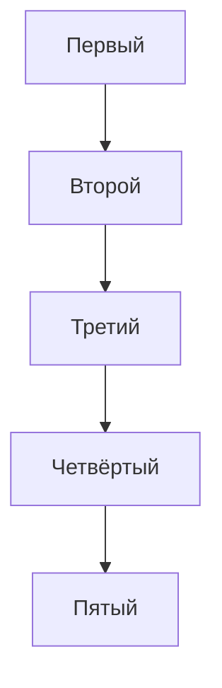

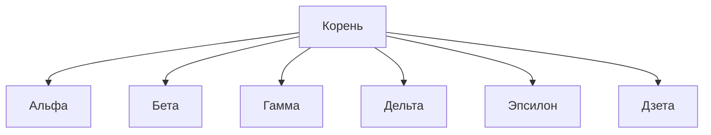

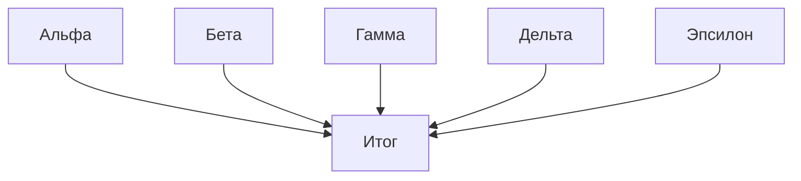

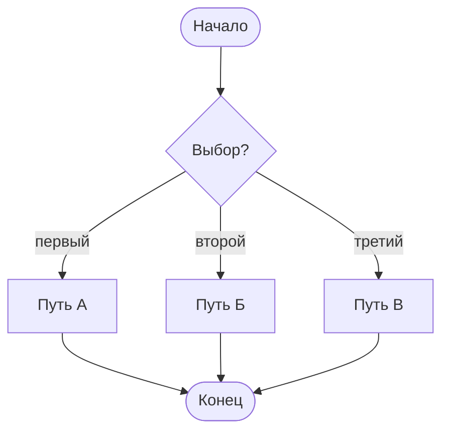

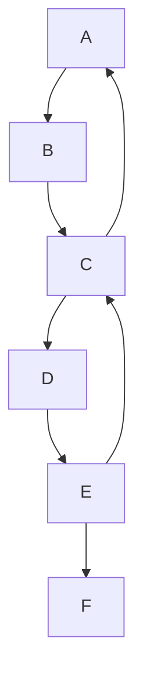

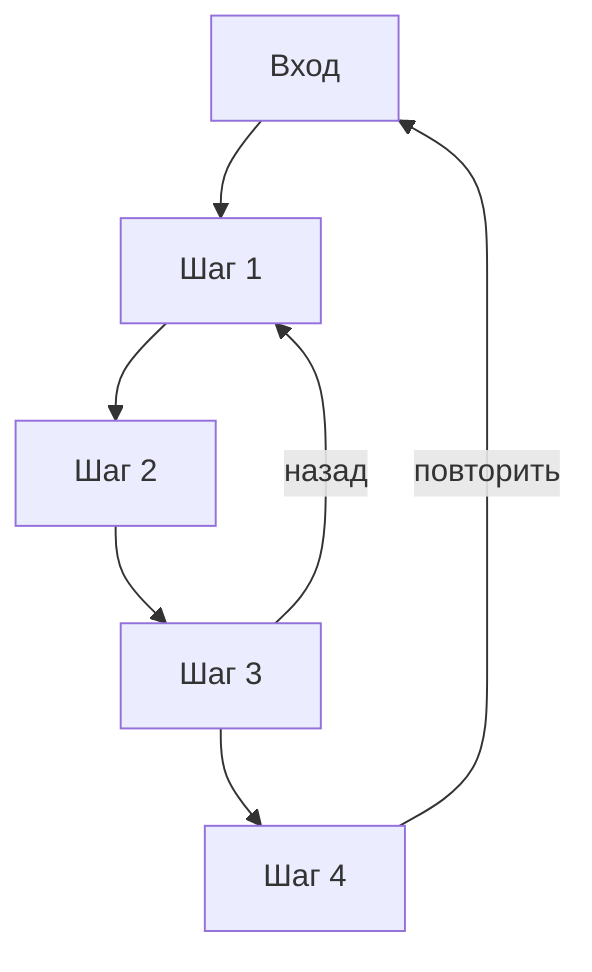

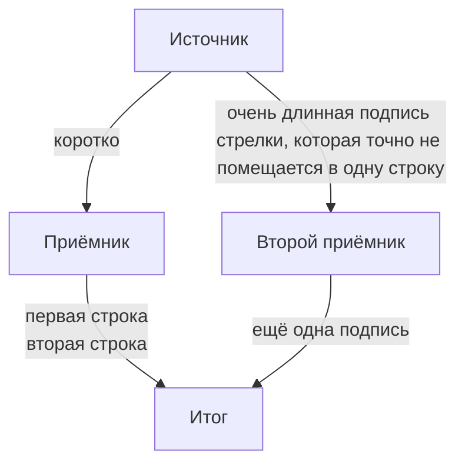

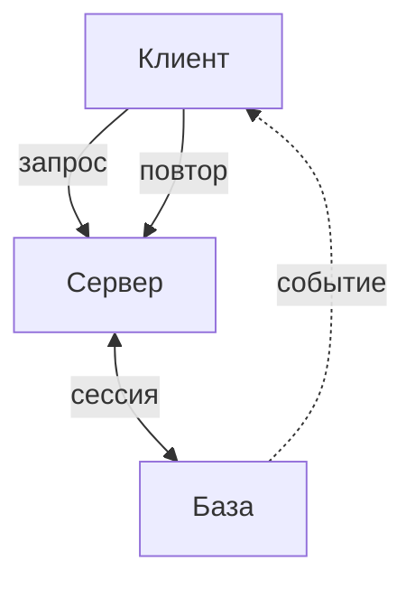

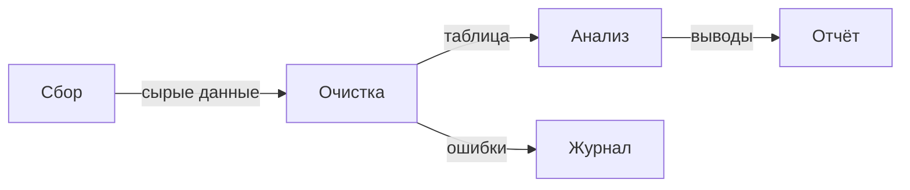

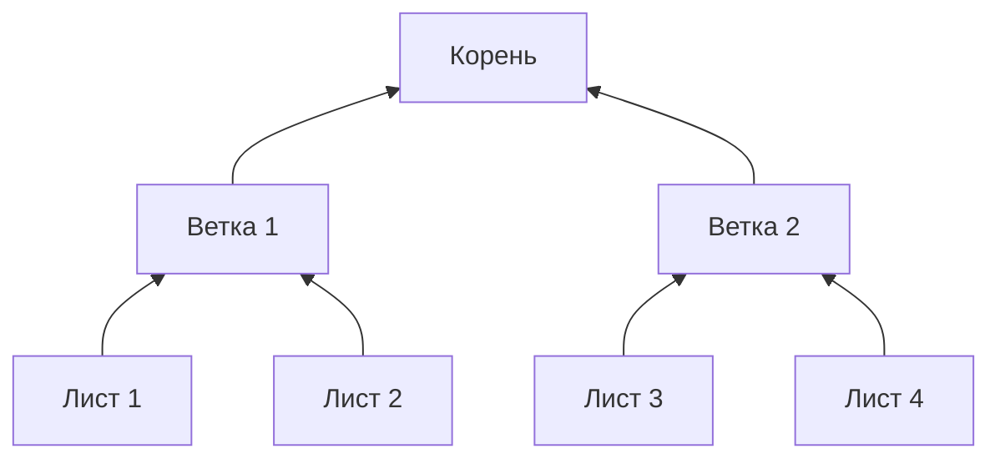

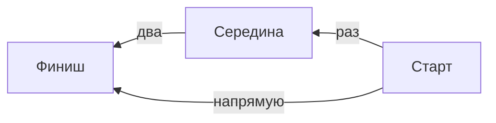

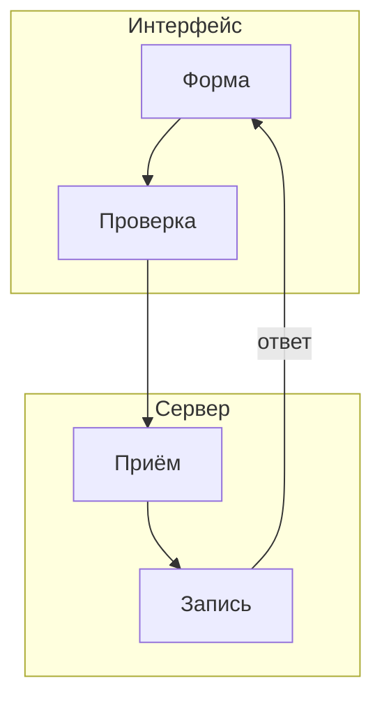

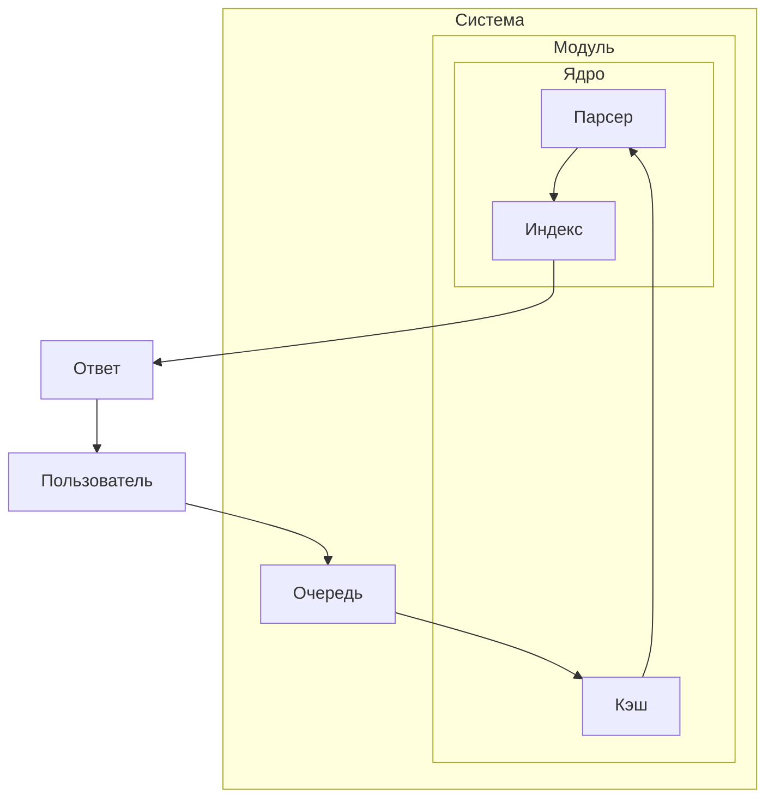

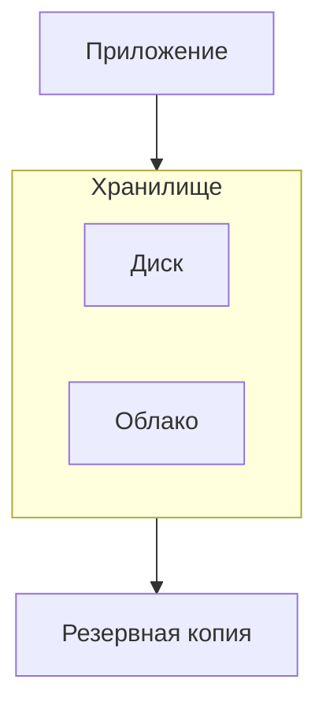

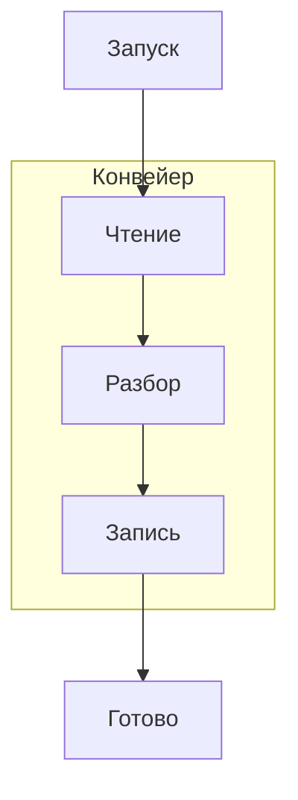

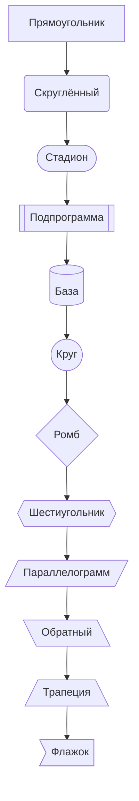

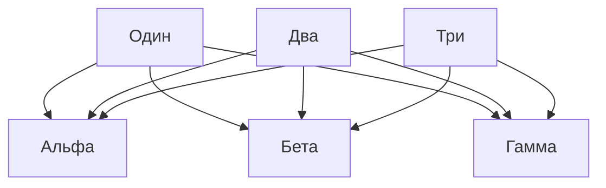

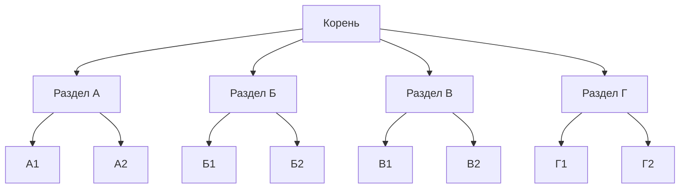

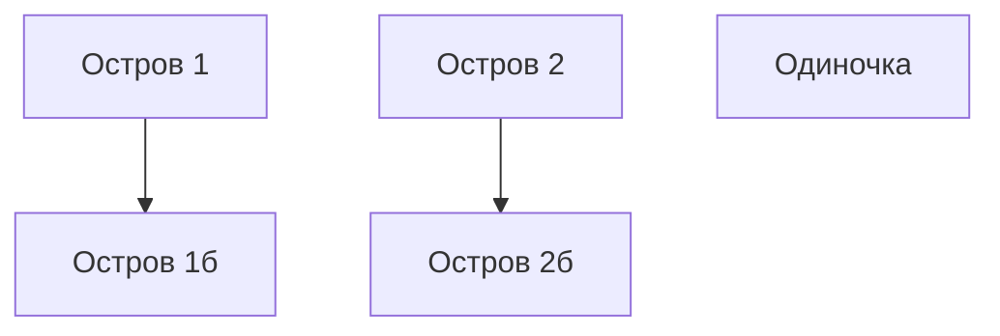

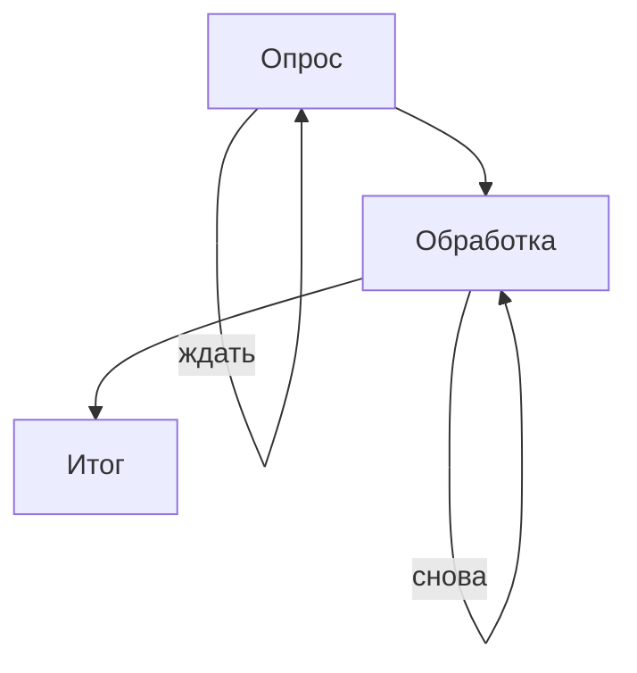

```mermaid
flowchart TD
    A[Начало] --> B[Шаг] --> C[Шаг] --> D[Шаг] --> E[Конец]
    A -->|напрямую| E
    B -->|пропуск| D
```

```mermaid
flowchart TD
    Q{Тип файла?}
    Q -->|изображение в формате PNG или JPEG| I[Картинка]
    Q -->|документ PDF| P[Документ]
    Q -->|видео| V[Плеер]
    Q -->|архив zip или tar.gz| Z[Распаковка]
```

```mermaid
flowchart LR
    subgraph Left [Слева]
        L1[Л1] --> L2[Л2]
    end
    subgraph Right [Справа]
        R1[П1] --> R2[П2]
    end
    X[Посредник]
    L2 --> X --> R1
    R2 --> L1
```

```mermaid
flowchart TD
    subgraph A [Группа А]
        a1[а1] --> a2[а2]
    end
    subgraph B [Группа Б]
        b1[б1] --> b2[б2]
    end
    free1[Свободный] --> free2[Ещё свободный]
```

```mermaid
classDiagram
    class Animal {
        +String name
        +int age
        +eat() void
    }
    class Dog {
        +bark() void
    }
    class Cat {
        +meow() void
    }
    class Owner {
        +String name
    }
    Animal <|-- Dog
    Animal <|-- Cat
    Owner "1" --> "*" Animal : владеет
    Dog ..> Owner : слушается
```

```mermaid
classDiagram
    class Repository~T~ {
        <<interface>>
        +find(id) T
        +save(item T)
        +delete(id)
    }
    class NoteRepo
    class TagRepo
    class Service
    Repository <|.. NoteRepo
    Repository <|.. TagRepo
    Service o-- NoteRepo : хранит
    Service *-- TagRepo : содержит
    Service --> Logger
```

```mermaid
stateDiagram-v2
    [*] --> Idle
    Idle --> Active: старт
    state Active {
        [*] --> Loading
        Loading --> Ready: загружено
        state Ready {
            [*] --> Viewing
            Viewing --> Editing: правка
            Editing --> Viewing: сохранить
        }
    }
    Active --> Idle: стоп
    Active --> Error: сбой
    Error --> [*]
```

```mermaid
stateDiagram-v2
    [*] --> Check
    state Check <<choice>>
    Check --> Fast: мало
    Check --> Slow: много
    state split <<fork>>
    Slow --> split
    split --> Left
    split --> Right
    state merge <<join>>
    Left --> merge
    Right --> merge
    merge --> Done
    Fast --> Done
    Done --> [*]
    note right of Fast: без очереди
    note left of Slow: в очереди
```

```mermaid
stateDiagram-v2
    [*] --> A
    A --> B: вперёд
    B --> C: вперёд
    C --> A: по кругу
    B --> A: назад
    C --> [*]
```

```mermaid
erDiagram
    USER ||--o{ NOTE : "пишет"
    NOTE ||--o{ TAG : "помечена"
    NOTE }o--|| VAULT : "лежит в"
    USER ||--|| PROFILE : "имеет"
    NOTE ||--o{ NOTE : "ссылается"
    VAULT {
        string id PK
        string name
    }
    USER {
        string id PK
        string email
    }
```
